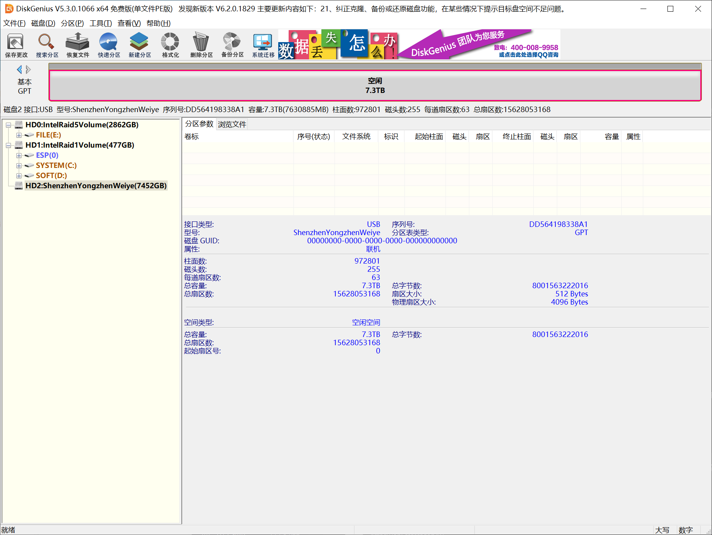
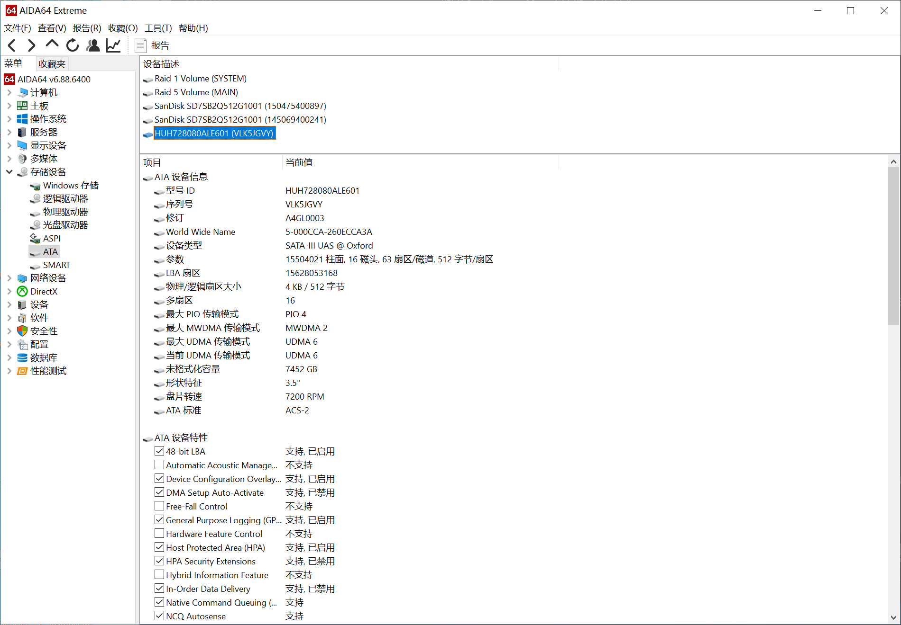
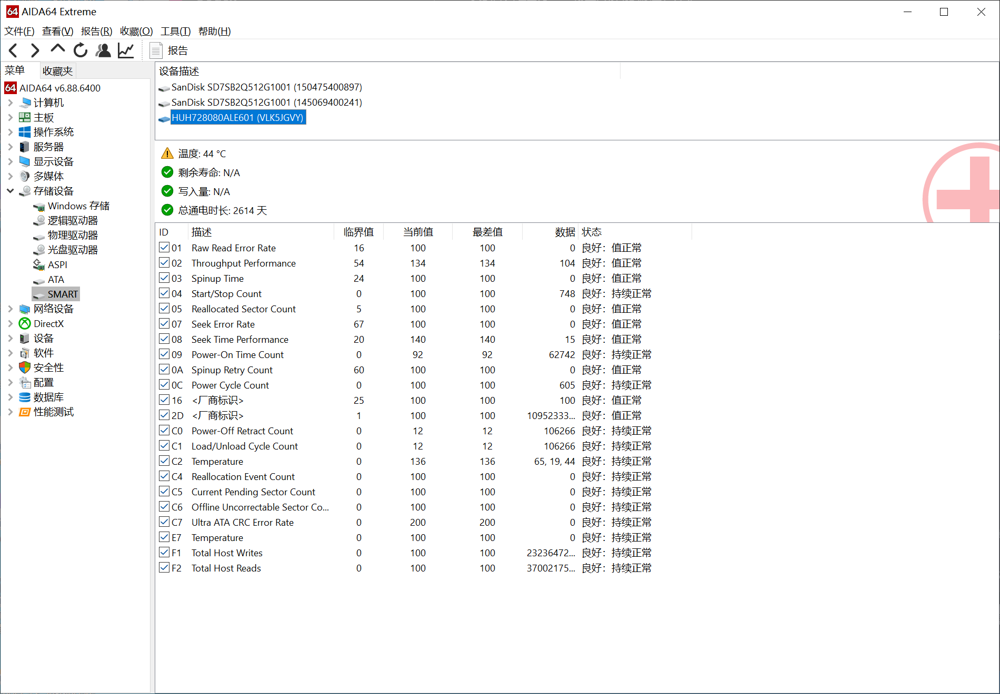

# One 8 TB disk had the wrong name written on it

## An engineering report: reviving a 24 TB Intel RST RAID 5

[简体中文](README.md) | **English** | [日本語](README.ja.md) | [Deutsch](README.de.md) | [Español](README.es.md) | [Русский](README.ru.md)

> 2026-10-30 → 2026-10-31. Four 8 TB disks in an Intel RST RAID 5, 24 TB, volume name `DATABASE`.
> The firmware declared the volume **Failed**, one member was stuck at **Non-RAID**, and the RST app
> showed a phantom entry of **0 bytes / Lost**.
> No full backup existed. Nothing was formatted, nothing was deleted.
> **22 bytes were changed on one disk and the array came back with its data intact.**
>
> This is the full report: background, incident, the reasoning chain of the investigation, the design
> trade-offs, what was actually executed, the result, and an honest post-mortem.
> If you only want the procedure, jump to [section 10](#10-reusing-this-on-your-own-failure).

---

## Contents

- [0. Summary](#0-summary)
- [1. Background](#1-background)
- [2. The incident: moving a case](#2-the-incident-moving-a-case)
- [3. Symptoms](#3-symptoms)
- [4. Investigation and reasoning chain](#4-investigation-and-reasoning-chain)
- [5. Key findings](#5-key-findings)
- [6. Design and trade-offs](#6-design-and-trade-offs)
- [7. Execution](#7-execution)
- [8. Result](#8-result)
- [9. Post-mortem](#9-post-mortem)
- [10. Reusing this on your own failure](#10-reusing-this-on-your-own-failure)
- [11. References](#11-references)

---

## 0. Summary

| Item | Detail |
|---|---|
| Failure | 4-disk Intel RST RAID 5 (24 TB) declared `Failed`; member `VLK5JGVY` shown as `Non-RAID` |
| Immediate cause | Moving the case loosened one disk's SATA connector → hours of degraded operation → a second disk was accidentally pulled at shutdown → two members bad at once |
| The actual blocker | Not hardware. **A string in the metadata**: the dropped member's serial had `:0` appended, and member matching is exact character-for-character, so it could never match again |
| Key determination | Data on the other members was intact (GPT/NTFS/MFT all verified offline); `migration_state = 0` proved no rebuild had ever run |
| Method | Start from the newest valid configuration copy, change 5 fields, recompute the checksum, write the identical copy to every surviving member |
| Bytes changed | 22 on the failed disk, 15 on each of the other two — all inside the metadata sector at the end of each disk, **0 bytes in the data area** |
| Result | `Failed` → `Degraded` → out-of-sync disk re-attached → `Rebuild` → completed → Windows mounted it, files readable |
| Data lost | None (the out-of-sync disk was overwritten by the rebuild, which is the intended behaviour — see 6.4) |
| What cannot be undone | Once the controller takes over and starts the rebuild, that disk's previous contents are gone |

---

## 1. Background

### 1.1 What was on the machine

A Z790 workstation with three arrays running at once:

| Volume | Composition | Purpose |
|---|---|---|
| `SYSTEM` | 2× SSD RAID 1 | OS, holds `C:` and `D:` |
| `MAIN` | 4× NVMe RAID 5 | 2.86 TB working set |
| **`DATABASE`** | **4× 8 TB HDD RAID 5** | **24 TB archive — the subject of this report** |

`DATABASE` held years of material: project archives, documents, datasets. It was the **only copy**,
with no off-site backup and no second storage system large enough to hold 24 TB.

Hardware details in [docs/04-hardware.md](docs/04-hardware.md): i5-13600KF, Colorful CVN Z790D5
GAMING FROZEN V20, BIOS 1009, VMD mode, four HGST HUH728080ALE600/ALE601.

### 1.2 Why this was hard

Four constraints at once, and each one closes off a conventional escape route:

1. **No full backup.** Imaging four disks needs 32 TB; the machine did not have it and buying it was not
   realistic at the time. Every subsequent step was therefore an in-place operation on the only copy, with
   no rollback.
2. **VMD could not be turned off.** The machine's `E:` volume (tools, Python, redirected AppData) is on the
   same VMD controller. Disabling VMD to "work safely" in a PE or a live Linux would have broken the
   working environment as well.
3. **Four disks cannot be used as a rehearsal.** Advice like "build an image first and experiment on that"
   was impossible; advice like "just plug it back and see if it heals" would have let the firmware rewrite
   metadata on the only copy.
4. **The previous attempt stopped at "I will not write".** The first investigation — carried out by a
   different AI assistant — completed all read-only acquisition, offline reconstruction and field-level
   metadata modelling, then declined to write to the disks, on the grounds that no candidate had been
   validated against real firmware and a wrong write destroys the data. That caution was correct.
   This project is the second attempt, and its job was to turn "won't write" into "writes with evidence".

### 1.3 Goal

Not "extract the files", but **recover the array itself**: get the ejected member accepted again, get the
volume out of `Failed` into an accessible state, and only then decide about the member that really is
out of sync.

---

## 2. The incident: moving a case

### 2.1 Physical timeline

```
T+0        the case is moved
           └─ member A (VKJGM9XX) SATA connector comes loose
                └─ array enters Degraded, 3 of 4 members keep serving

T+hours    normal use; writes continue
           └─ critical: the three remaining disks accumulate data A never saw
                └─ and NTFS keeps writing metadata, timestamps, $LogFile

T+hours    shutdown, cable re-seated on A
           └─ at that same moment member B (VLK5JGVY) is pulled by mistake

T+         power on
           └─ two members bad at once (A out of sync, B missing)
                └─ firmware verdict: Failed

T+         B plugged back in
           └─ BIOS shows Non-RAID; it never rejoins
                └─ the RST app gains a 0-byte / Lost phantom entry
```

### 2.2 Why "we never wrote anything" was not true

The owner's intuition was: "I didn't write to that disk after A dropped out, so A should still be good."

That is wrong at the RAID level: **a degraded array keeps serving I/O**. As long as the OS runs, writes
happen — even if the user saves nothing, NTFS updates its journal, timestamps, USN journal and `$LogFile`.

This settles every later decision: **A holds old data, B holds new data.** That was derived from the
timeline, and it is corroborated by the metadata (see 4.4).

---

## 3. Symptoms

One fault, three completely different views.

### 3.1 BIOS / UEFI RST screen

- The volume exists, with the right name, level and size;
- status `Failed`;
- one member short;
- the re-attached disk shows `Non-RAID`, as if it had never belonged to the array.

### 3.2 Intel RST app in Windows

A phantom record:

> Controller: unknown · Port: unknown · Port location: unknown · **Status: Lost** · Size: **0 Bytes**
> · Serial number: **`VLK5JGVY:0`** · Model: *(empty)* · Capacity: 0

This record sends almost everyone down the wrong path. It looks like "the disk is dead" or "the disk is empty".

### 3.3 The disk itself

- ATA `IDENTIFY` is clean: serial, model, firmware, LBA48 capacity all correct;
- SMART is clean: 0 reallocated, 0 pending, 0 offline uncorrectable;
- geometry: 512-byte logical / 4096-byte physical;
- capacity: 8 001 563 222 016 bytes.

**Three views that contradict each other. The contradiction is the clue.**

<table>
<tr>
<td width="50%"><br><i>The disk off the array, behind a USB bridge: 512 logical / 4096 physical sectors, 15 628 053 168 sectors.</i></td>
<td width="50%"><br><i>Full ATA identity is still readable through the bridge: serial, LBA count, WWN.</i></td>
</tr>
<tr>
<td colspan="2"><br><i>SMART of the same disk: 0 reallocated, 0 pending, 0 uncorrectable. A perfectly healthy drive.</i></td>
</tr>
</table>

---

## 4. Investigation and reasoning chain

This section is the substance of the work. Every step was **hypothesis → a read-only experiment →
confirm or refute with data**, and the entire investigation phase wrote not a single byte to any disk.

### 4.1 Hypothesis 1: the disk is failing

**Experiment**: take the disk out, run ATA `IDENTIFY` and read SMART through a USB-SATA bridge.

**Result**: serial correct, capacity correct, SMART clean.

**Conclusion**: **refuted**. The disk is healthy. The fault is not hardware.

> This step matters because it is the fork between "repair metadata" and "go buy data-recovery software".

### 4.2 Hypothesis 2: the data was overwritten / a rebuild already ran

The frightening possibility: if the array had silently used A as a rebuild target during those hours, A
would now hold recomputed garbage.

**Experiment**: read the metadata at the end of all four disks and look at `migration_state` and
`migration_type`.

**Result**: `migration_state = 0`, with a leftover `migration_type = 1`.

**Conclusion**: **refuted**. `migration_state = 0` means no migration or rebuild is running. The non-zero
`migration_type` is historical residue and **must not** be read as "a rebuild happened" — a
misinterpretation the first investigation had already corrected.

### 4.3 Hypothesis 3: the filesystem is damaged

**Experiment**: using ordinary file copies of the four disks (no disks attached, nothing mounted),
reassemble the volume in memory according to the RAID 5 stripe rules and validate bottom-up:

- primary and backup GPT headers, CRC32;
- partition array CRC32, primary vs backup byte comparison;
- NTFS boot sector, primary vs backup;
- the first 128 records of the primary MFT: FILE/USA structures, runlists;
- six INDX blocks of the root directory, 94 name entries.

**Result**: all passed. GPT CRCs `deaf682b` / `418d6e5e`, partition array CRC `34df0453`, the first eight
MFT records byte-identical to the mirror, 19 of the 94 root entries cross-checked against the MFT.

**Conclusion**: **refuted**. The data and the filesystem structures are fine. Nobody had simply assembled them.

> At this point the three obvious directions were all excluded: not hardware, not destroyed data,
> not a broken filesystem. **The only remaining possibility was the metadata.**

### 4.4 Hypothesis 4: it is only *labelled* wrong

**Experiment**: read the configuration block from the end of every disk, parse it field by field using the
public `mdadm` IMSM structure definitions, and place the four side by side.

**Result — the turning point of the whole project:**

| Disk | Generation | Checksum | Volume state it records |
|---|---:|---|---|
| C `VKH3B65X` | 763553 | valid | failed |
| D `VJGH3P3X` | 763553 | valid | failed |
| A `VKJGM9XX` | 763553 | valid | failed |
| B `VLK5JGVY` | 763509 | **invalid** | degraded |

- C, D and A are **byte-identical** — the controller wrote those three at the same moment;
- B's copy is an **older generation with a bad checksum** — it had not been updated for a long time, and
  that last write may have been left half-done;
- in the three newer copies, B's record reads:

```
serial   "VLK5JGVY:0"      ← real serial with ":0" appended
status   0x00000006        ← CONFIGURED | FAILED
scsi_id  0xFFFFFFFF        ← "I do not know where this disk is"
ordinal  0x01000002        ← the "out of sync / rebuild" bit is set
```

**Conclusion**: **confirmed**. It is only labelled wrong. And there is a public reference for that exact
quartet: it is precisely what `mark_failure()` / `mark_missing()` in `mdadm` write when marking a member
as missing — character for character.

### 4.5 Corollary: why re-seating the cable can never work

Member matching compares the **16-byte serial field** for **exact equality** (`strncmp(..., 16)`).

```
in the label:      "VLK5JGVY:0"
the disk reports:  "VLK5JGVY"
comparison:        not equal → never matches
```

That single fact explains every "weird" behaviour:

- why new cables, new ports and a different machine change nothing;
- why BIOS updates and driver updates do nothing;
- why the UI shows "0 bytes" — the controller never associated the disk with any member record;

**The mismatch is text stored on the disk, not a hardware fault.**

### 4.6 Question 1: which of the four copies do you believe?

It is not simply "take the newest generation".

- B's copy is older, and it claims "I am a member, A is missing";
- the other three are newer, and they claim "B is missing, A is out of sync".

Which describes reality better? **From the timeline, the three newer ones**: B was pulled at the moment of
shutdown and nothing was written normally after the array went Failed, whereas A had been offline for hours
and missed a lot of writes.

So the baseline is the generation-763553 copy — **which was wrong about exactly one thing: it had written B
off.** The repair changes that one thing and nothing else.

### 4.7 Question 2: is A in sync or not? (a dead end that must be admitted)

The first investigation sampled 28 stripes in the middle of the array (128 KiB each) and XOR-checked them:
**26 samples XOR to zero, 2 do not.**

| Physical offset | Length | Non-zero bytes |
|---:|---:|---:|
| 1 074 397 184 (stripe holding the start of the primary MFT) | 131 072 | 98 |
| 4 000 779 468 800 (stripe holding `$LogFile` pages) | 131 072 | 2 089 |

The natural next step is "find out which disk is wrong".

**That is not possible, and it has to be said plainly**: excluding any one of A/B/C/D and recomputing it
from the other three yields **exactly the same difference pattern** — the same four-disk syndrome. XOR can
tell you a stripe is inconsistent; it **cannot** tell you which member is at fault unless you already have a
trusted reference.

Both candidate versions pass every structural NTFS check (the differences are concentrated in the LSN fields
of MFT records 32–39 and in `$LogFile` pages), so **structural validity cannot decide it either**.

**Conclusion**: unsolvable offline. We used the timeline (A was absent while the array was writing → A is the
stale one) as an engineering judgement, and — crucially — **the design never claims that both sides are
equal**. See 6.2 for why writing `Normal` was refused.

### 4.8 The reasoning chain, condensed

```
Contradictory views (BIOS says Failed / app says 0 bytes / disk says it is healthy)
        │
        ├─ rule out hardware ───────── ATA IDENTIFY + SMART clean
        ├─ rule out "already rebuilt" ─ migration_state = 0
        ├─ rule out filesystem damage ─ offline GPT / NTFS / MFT / directory all validated
        │
        └─ only metadata left
                 │
                 ├─ four copies compared → three identical and valid, one old with a bad checksum
                 ├─ missing-member markers (3 fields + out-of-sync bit) match the public implementation exactly
                 ├─ matching is a 16-byte exact compare → the ":0" suffix is a dead knot
                 └─ state derives from the count of failed slots → 2 = Failed, 1 = Degraded
                          │
                          └─ the repair is uniquely determined: restore B's identity, clear its
                             failed/out-of-sync marks, drop the volume to Degraded, recompute the checksum
```

---

## 5. Key findings

Full field tables in [docs/02-imsm-metadata-format.md](docs/02-imsm-metadata-format.md). Only what affected
decisions is summarised here.

### 5.1 Where the label lives

Intel writes a configuration block describing the **entire array** at the end of **every** member
(signature `Intel Raid ISM Cfg Sig. 1.3.00`, 584 bytes in this case). It is not a contiguous 584 bytes:

```
third-from-last 512B sector, first 72 bytes = configuration bytes [512..583]
second-from-last 512B sector (all 512)      = configuration bytes [  0..511]
last 512B sector                            = not part of this block, must be left untouched
```

All three sit inside **one 4 KiB physical sector**. So the write must be: read the whole sector → replace
only the two configuration regions → write the whole sector back. Never overwrite 584 bytes as a
contiguous blob.

### 5.2 Three markers and one dead knot

See 4.4 / 4.5. One addition: the 16-byte serial field is not a plain string. Its real content is
`"VLK5JGVY" + NUL + "00159"` — the trailing half is part of the identity too. So restoring a member means
**copying that disk's own 16 bytes back verbatim**, never reassembling the string by hand. This removes the
last place where a guess could hide.

### 5.3 Checksum

Sum of all little-endian 32-bit words within the configuration, minus the checksum field itself, mod 2³².
A wrong checksum is worse than no repair at all: the firmware may simply ignore that copy and trust an older
one on another disk.

### 5.4 State derivation (the only real evidence for trusting the model)

```
failed slots = slots with the FAILED bit + slots with the out-of-sync bit
RAID 5:  0 → Normal,  1 → Degraded,  ≥2 → Failed
```

That rule comes from a public implementation, so on its own it is just documentation. **What made it
trustworthy is that it reproduces reality:**

| Configuration | Computed failed count | Computed state | What the BIOS actually displayed |
|---|---:|---|---|
| before the repair | 2 | Failed | **Failed** ✅ |
| after the repair | 1 | Degraded | **Degraded** ✅ |

Both before and after matched. That is what turned "write these bytes" from a guess into a judgement.

---

## 6. Design and trade-offs

### 6.1 Three candidates

| Option | Content | Outcome | Assessment |
|---|---|---|---|
| A | Read-only offline extraction: leave metadata alone, pull the 24 TB of files out with software | Data obtainable, array still dead | Needs another 24 TB of destination space, which did not exist; keeps a bespoke reassembly stack alive indefinitely |
| **B** | **Repair the metadata: restore B as a member, volume back to Degraded, keep A isolated and out of sync** | **Array accessible and inspectable** | **chosen** |
| C | Write `Normal` on the volume, claiming all four members are in sync | Looks nice, worst data risk | **refused**, see 6.2 |

### 6.2 Why `Normal` was refused outright

`Normal` is a **claim**, not a synchronisation. It asserts that every member holds identical data.

A is genuinely out of sync — it missed hours of writes, and 4.7 cannot exclude it. Writing `Normal` would:

- make the controller believe all four are in sync, so it would **never** rebuild A;
- cause any file living in A's stale regions to be served as **old data, silently**;
- pass every structural check while doing so — the hardest kind of corruption to ever find.

Worse, the firmware derives the state from the members anyway. Storing `Normal` next to a member that computes
as out of sync is a self-contradiction, and the controller may well "fix" your metadata behind your back.

**Conclusion: `Degraded` is the only honest state until a real rebuild has completed.**

### 6.3 Why all three disks were written, not just the broken one

Writing only B would leave C/D/A carrying the old copy (generation 763553) that says "B is missing". B's new
copy would be generation 763554 and would win — **but that is `mdadm`'s behaviour, not Intel's private
driver's behaviour.** The rules the firmware uses when merging copies across generations — in particular
whether failure flags propagate across generations — are not observable from outside.

There is no reason to take that bet. Writing the **same 584-byte configuration** (same generation 763554) to
every surviving member makes all copies byte-identical, so at boot **there is nothing to arbitrate**. That
removes the uncertainty instead of gambling on it. The cost is two more disks touched, 15 bytes each, at the
same place.

### 6.4 Why overwriting A was acceptable

Step two of option B is to rebuild A. A rebuild **recomputes A's entire data area from the other members** and
overwrites it. Irreversible.

It was acceptable because A is the disk that dropped out *before* the degradation: it holds **old** data, the
other three hold the new data. The rebuild direction is correct. Had the judgement been reversed — treating A
as the trusted source and rebuilding the others — that would have been a disaster.

This judgement rests entirely on the timeline in section 2. **Which is why "who dropped out, when, and for how
long" has to be established before anything else.**

### 6.5 The specific values chosen

| Field | Value | Basis |
|---|---|---|
| `generation` | 763553 → 763554, identical on all three | strictly newer than any existing copy; same generation everywhere, so no arbitration |
| `scsi_id` | `0xFFFFFFFF` → `0x00000000` | the value that disk itself had last been given; `0xFFFFFFFF` is the "missing" marker, leaving it in place is leaving a death tag on |
| `status` | `0x00000006` → `0x0000053A` | the disk's own record is `0x053E`; clearing only the FAILED bit gives `0x053A`, byte-identical to the other healthy members |
| `map_state` | 3 → 2 | after the repair exactly one bad slot (A) remains |
| everything else | untouched | family, volume name, size, member count, level, strip, data start, `failed_disk_num`, the other members' records, A's out-of-sync bit |

**The one value copied from history rather than derived is `scsi_id`**, and the report has to say so (see 9.2).

---

## 7. Execution

### 7.1 Five guards, any failure aborts

Before writing, the tool enforces:

1. device capacity equals 8 001 563 222 016 bytes;
2. `IOCTL_STORAGE_GET_DEVICE_NUMBER` reports the disk number you asked for;
3. the **ATA `IDENTIFY` serial** matches (not the USB bridge serial, not an old drive letter);
4. the **preimage hash** of the target 4 KiB sector matches the reviewed value (a disk that changed since
   review is refused);
5. the on-disk configuration hash matches the reviewed baseline (a disk carrying a different generation is
   refused rather than "repaired anyway").

Only then does it issue **one** 4 KiB aligned write with `FILE_FLAG_WRITE_THROUGH` +
`FlushFileBuffers`, followed by a double read-back comparison and an identity re-check. Any anomaly aborts;
nothing retries.

### 7.2 What was actually changed

| Disk | Bytes | Content |
|---|---:|---|
| `VLK5JGVY` (the failed disk) | **22** | checksum, generation, its own status (clear FAILED), the *other* member's record brought up to date, volume state |
| `VKH3B65X` | **15** | checksum, generation, B's serial/status/scsi_id, volume state, B's out-of-sync bit |
| `VJGH3P3X` | **15** | same as above |

Afterwards, the 4 KiB sector at the end of all three disks hashes **identically**:

```
04553866e753bfef715a82eb042fa5ca969f90df6f242ae460540226681c7e48
```

That is a useful self-check in itself: two different models (`ALE600` / `ALE601`) and two different
firmware revisions (`A4GNT7JD` / `A4GL0003`) producing the same hash at the same offset means the edit is
deterministic and not disk-dependent.

### 7.3 Proof that the data area was untouched

After the write, the whole trailing 64 KiB was re-read and compared byte for byte with the pre-write backup:

```
VLK5JGVY : 22 changed bytes, all inside the configuration sector
VKH3B65X : 15 changed bytes, all inside the configuration sector
VJGH3P3X : 15 changed bytes, all inside the configuration sector
```

The **first 64 KiB of all three disks is byte-identical to the backup** (including a GPT that Windows had
briefly "recognised" on two of them). Nothing outside that one metadata block moved.

---

## 8. Result

### 8.1 First contact: only the three repaired disks

Power off, attach `VLK5JGVY` + `VKH3B65X` + `VJGH3P3X`, keep `VKJGM9XX` isolated, boot into the UEFI RST screen.

**It shows `Degraded`.** `VLK5JGVY` is back as a member, no longer `Non-RAID`; the 0-byte phantom entry is
gone; the missing member is reported as `VKJGM9XX`.

This is the one step of the whole project that could not be proven offline — **the real firmware accepted the
bytes we wrote**.

### 8.2 Second contact: the out-of-sync disk comes back

Re-attach `VKJGM9XX`, boot into the BIOS again.

**It shows `Rebuild`.** The rebuild starts by itself.

### 8.3 What the OS reported

| Item | Value |
|---|---|
| Physical disk | `Intel Raid 5 Volume DATABASE`, 24 004 676 026 368 bytes, GPT, Online, Healthy |
| Volume | `G:` `DATABASE`, NTFS, 22 356.1 GB, 9 029.3 GB free, **Healthy / OK** |
| Files | opened and checked, normal |

That byte count is **exactly** the volume size recorded in the metadata, which means the strip geometry, the
data start and the member order are all right — not "looks plausible", but matching byte for byte.


*After the repair: four 7452 GB members present, `DATABASE` back as a RAID 5 of 22 356 GB, status **rebuild 9%**.*

---

## 9. Post-mortem

### 9.1 Four things done right

1. **Read-only first, fully auditable.** The investigation phase wrote not one byte; every conclusion rests on
   bytes read plus hashes anyone can recompute.
2. **Refute before acting.** Hardware, "already rebuilt" and filesystem damage were each excluded with a tool,
   which is what narrowed the problem to metadata.
3. **No gambling on unverified behaviour.** Wherever the uncertainty could be removed by making all copies
   identical, we removed it instead of relying on "the firmware should pick the newest".
4. **Preimage before, read-back after.** Every disk has its 4 KiB before and after image, so the change is
   exactly reversible.

### 9.2 Where luck was involved (and must be admitted)

- **Real firmware behaviour was never validated by a third party.** The model comes from the public `mdadm`
  implementation; it matched the two observations "before → Failed" and "after → Degraded", but that is one
  successful empirical result, **not a proof**. A different BIOS or OROM branch could behave differently.
- **The `scsi_id` value was copied from history, not derived.** If the firmware had rules about that field we
  did not anticipate, the first boot would have failed. It worked — which is "nothing went wrong", not "we
  know why nothing went wrong".
- **There was no backup.** The entire operation modified the only copy in place. Any arithmetic error had no
  second chance.
- **The rebuild direction depended on the owner's account of the timeline.** If the order was actually
  different, "overwrite A" would have destroyed newer data. That premise was confirmed by a human, not by a
  machine.

### 9.3 The counter-intuitive conclusion: driver upgrades are pointless

The most transferable lesson from this case:

**The array is assembled at boot by the RST OROM embedded in the motherboard BIOS (19.5 here), not by the
Windows driver.**

- power on → the OROM enumerates disks → reads metadata → decides the array state → possibly writes metadata
  → only then does Windows start;
- the Windows driver (20.2.1.1016) and the RST app (20.0.1024.0) only affect the I/O path afterwards.

Two corollaries:

1. This repair had to be written in the **`1.3.00` MPB format**, which 19.x OROMs parse natively. Writing the
   `2.0.00` format (VROC / newer platforms) would have been ignored outright by a 19.5 OROM.
2. **Any real fix for Intel's drive-drop bug can only arrive as a BIOS update from the board vendor.**
   Nothing a user installs in Windows can substitute for it.

### 9.4 Open items

1. `C:` / `D:` (the other RAID 1, SYSTEM volume) still report `Warning / Scan Needed`. That predates this
   operation, is unrelated to the metadata write, and has not been addressed.
2. The RST UI currently shows `write-back` with `write cache buffer flushing: disabled`. After the rebuild,
   enable flushing or switch to write-through to reduce what a power loss can take with it.
3. The archive on `E:` is still on the same machine, so it is **not an off-site backup**. Important data must
   be copied off the machine.
4. All four disks' metadata has since been rewritten by the firmware (generation, `scsi_id`, rebuild flags).
   The hashes in section 7 describe the moment of the write, **not the current disk contents**. Any future
   repair of this kind must take fresh preimages.

### 9.5 One sentence

**The entire failure was: two characters appended to a string, in a world where matching is exact.**
Everything else was proving that, and then changing it back precisely.

---

## 10. Reusing this on your own failure

Check first, act second:

- [ ] Intel RST **RAID 5, 4 disks** (3 or 5 disks: same idea, different arithmetic)
- [ ] the volume shows `Failed`
- [ ] **exactly one** disk shows `Non-RAID`, or there is a `0 bytes / Lost` phantom entry
- [ ] that phantom's serial is `YOURSERIAL:0`
- [ ] you have not deleted, re-initialised, or "marked as normal" the volume
- [ ] the incident started with a cable, connector, power or case-move event

**If the volume was already deleted or re-initialised: this does not apply. Stop.**

Then follow the nine-step procedure in [docs/03-procedure.md](docs/03-procedure.md). Command cheat sheet:

```powershell
# which disk is attached (capacity and geometry must match your members)
Get-Disk | Where-Object BusType -eq 'USB' |
  Select-Object Number,FriendlyName,Size,LogicalSectorSize,PhysicalSectorSize

# read-only: confirm identity + dump the label
python scripts\verify_present_state_readonly.py <disk number> <ATA SERIAL>

# read-only: decode any 584-byte configuration
python scripts\dump_cfg.py samples\VLK5JGVY_IMSM_configuration.bin

# dry run (writes nothing without --apply)
python scripts\apply_mpb_write.py <disk number> <ATA SERIAL>

# only after every guard passed
python scripts\apply_mpb_write.py <disk number> <ATA SERIAL> --apply
```

**Do not copy the numbers in this report.** Capacities and sector sizes differ per model; recompute the
offsets for your own disks.

### Repository contents

| Path | Content |
|---|---|
| [docs/01-case-study.md](docs/01-case-study.md) | The longer narrative: hypotheses, dead ends, why common advice fails |
| [docs/02-imsm-metadata-format.md](docs/02-imsm-metadata-format.md) | The complete 584-byte field map, status bits, checksum, on-disk placement |
| [docs/03-procedure.md](docs/03-procedure.md) | Nine-step runbook with commands and the failure modes we actually hit |
| [docs/04-hardware.md](docs/04-hardware.md) | Exact machine, disks, serial numbers, geometry |
| [docs/05-evidence.md](docs/05-evidence.md) | Every hash and every byte changed |
| [docs/06-references.md](docs/06-references.md) | Intel advisory, `mdadm` source, kernel sources |
| `scripts/` | Read-only inspectors and one writer with five guards |
| `samples/` | The four real labels from before the repair, and the corrected one |

---

## 11. References

- **Intel advisory (the origin of the drive-drop bug)**:
  <https://www.intel.com/content/www/us/en/support/articles/000099952/technologies.html>
- **`mdadm` IMSM implementation** — the authoritative public description of this format:
  <https://raw.githubusercontent.com/md-raid-utilities/mdadm/main/super-intel.c>
  Key functions: `mark_failure()`, `mark_missing()`, `__gen_imsm_checksum()`, `store_imsm_mpb()`,
  `imsm_count_failed()`, `imsm_check_degraded()`, `__prep_thunderdome()`
- Linux `drivers/md/raid5.c`, `fs/ntfs3/ntfs.h`, `fs/ntfs3/fslog.c` — structures used for the offline
  reassembly and validation

---

## License

MIT — see [LICENSE](LICENSE). Serial numbers, models and geometry are published with the owner's permission.

Data has no price. This report exists so the next person with the same failure loses a few days less.
