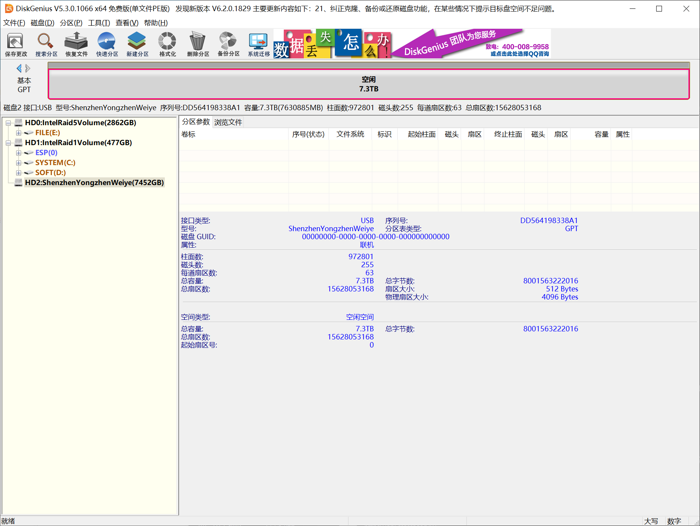
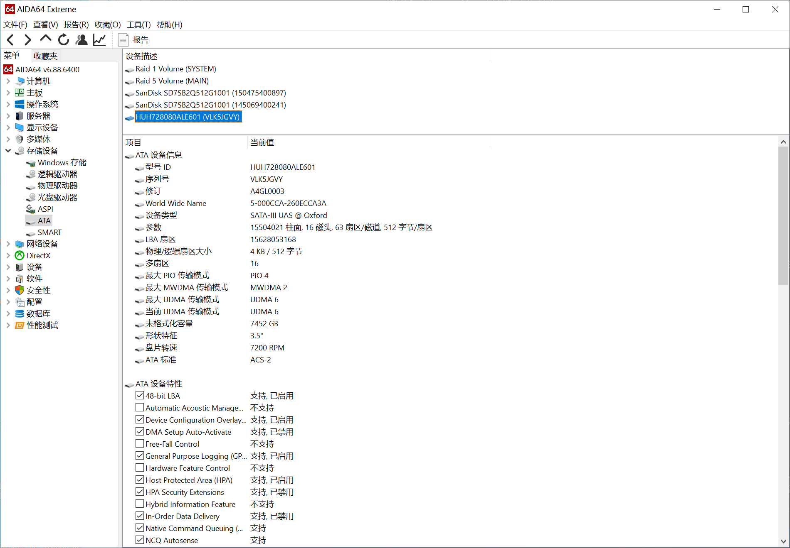
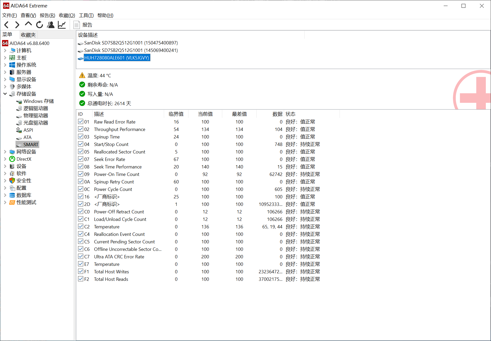

# 一块 8TB 硬盘的「名字」写错了

## Intel RST RAID 5 / 24TB 阵列复活报告

**简体中文** | [English](README.en.md) | [日本語](README.ja.md) | [Deutsch](README.de.md) | [Español](README.es.md) | [Русский](README.ru.md)

> 2026-10-30 至 2026-10-31。四块 8TB 硬盘组成的 Intel RST RAID 5，容量 24TB，卷名 `DATABASE`。
> 固件把卷判成 **Failed（发生故障）**，其中一块盘永久显示 **Non-RAID**，界面上是一条「0 字节 / 丢失」的幽灵记录。
> 全程没有全盘备份，没有格式化，没有删卷重建。
> **最终在盘上只改了 22 个字节，阵列回来了，数据完好。**
>
> 这份文档是完整的工程报告：背景、起因、排查思维链、方案取舍、执行细节、结果、复盘。
> 想看「怎么操作」的可以直接跳到第 10 节。

---

## 目录

- [0. 摘要](#0-摘要)
- [1. 项目背景](#1-项目背景)
- [2. 起因：一次搬机箱](#2-起因一次搬机箱)
- [3. 现象](#3-现象)
- [4. 排查过程与思维链](#4-排查过程与思维链)
- [5. 关键发现](#5-关键发现)
- [6. 方案设计与取舍](#6-方案设计与取舍)
- [7. 执行](#7-执行)
- [8. 结果](#8-结果)
- [9. 复盘与总结](#9-复盘与总结)
- [10. 如何复用到你自己的故障](#10-如何复用到你自己的故障)
- [11. 参考资料](#11-参考资料)

---

## 0. 摘要

| 项 | 内容 |
|---|---|
| 故障 | 4 盘 Intel RST RAID 5（24TB）被判 `Failed`；成员盘 `VLK5JGVY` 显示 `Non-RAID` |
| 直接原因 | 搬动机箱导致一块盘接口松脱 → 降级运行数小时 → 关机时又误拔另一块 → 两个成员同时异常 |
| 真正卡点 | 不是硬件，是**元数据里的一个字符串**：掉线成员的序列号被追加了 `:0`，而成员识别是逐字符完全匹配，于是永远对不上 |
| 关键判断 | 其余盘上的数据完好（GPT/NTFS/MFT 全部离线验证通过）；卷状态 `migration_state=0` 证明从未发生过重建 |
| 手段 | 从最新的有效配置副本出发，只改 5 个字段，重算校验和，把同一份配置写进所有存活成员 |
| 改动量 | 故障盘 22 字节，另两块各 15 字节；全部位于盘末尾的元数据扇区，**数据区 0 字节** |
| 结果 | `Failed` → `Degraded` → 接回失步盘 → `Rebuild` → 重建完成 → Windows 正常挂载，文件可读 |
| 数据损失 | 0（失步盘在重建中被覆盖，这是预期行为，见 6.4） |
| 不可回退的部分 | 一旦控制器接管并启动重建，失步盘的原有内容不可恢复 |

---

## 1. 项目背景

### 1.1 这台机器上有什么

一台 Z790 平台的 Windows 工作站，三组阵列同时在跑：

| 卷 | 组成 | 用途 |
|---|---|---|
| `SYSTEM` | 2× SSD RAID 1 | 系统盘，`C:` 和 `D:` |
| `MAIN` | 4× NVMe RAID 5 | 2.86TB 工作区 |
| **`DATABASE`** | **4× 8TB HDD RAID 5** | **24TB 资料库 —— 本次的主角** |

`DATABASE` 里是长期积累的资料：项目档案、文档、数据集。它是**单一副本**，没有异地备份，也没有第二套存储可以放得下 24TB。

硬件细节见 [docs/04-hardware.md](docs/04-hardware.md)：i5-13600KF、七彩虹 CVN Z790D5 GAMING FROZEN V20、BIOS 1009、VMD 模式、四块 HGST HUH728080ALE600/ALE601。

### 1.2 为什么这件事难

四个约束同时成立，把常见方案全堵死了：

1. **没有全盘备份。** 四块盘完整镜像需要 32TB 空间，本机没有，临时采购也不现实。这意味着后面每一步都是对唯一数据副本的原地操作，没有回退。
2. **不能关 VMD / 切 AHCI。** 这台机器的 `E:` 盘（工具、Python、重定向的 AppData）也挂在这组 VMD 控制器上。关掉 VMD 进 PE 或 Linux 去"安全操作"，会把系统环境一起弄坏。
3. **不能拿四块盘做试验。** 有些教程建议"先做成镜像再试"，但这里做不出镜像；也有些建议"接回控制器看看会不会自己好"，而每次接回控制器都可能触发固件改写元数据，等于拿唯一副本去试。
4. **前一棒停在了"不敢写"。** 故障后第一个接手分析的是另一个 AI 助手，它完成了全部只读取证、离线重组验证和元数据字段建模，但在"真正往盘上写"这一步停下了——理由是没有经过真实固件验证的补丁，写错即毁数据。这个顾虑是对的。本项目是第二棒，任务就是把这个"不敢写"变成"有依据地写"。

### 1.3 目标

不是"把文件抠出来"，而是**恢复阵列本身**：让被踢出的成员盘重新成为成员，让卷从 `Failed` 回到可访问状态，之后再决定要不要同步那个真正失步的盘。

---

## 2. 起因：一次搬机箱

### 2.1 物理事件

```
T+0     机箱被搬动
        └─ 成员 A（VKJGM9XX）SATA 接口松脱
             └─ 阵列进入 Degraded（降级），3/4 成员继续工作

T+数小时 系统正常使用，写入继续进行
        └─ 关键：这三块盘上产生了 A 从未见过的数据
             └─ 同时 NTFS 元数据、时间戳、日志也在持续写入

T+数小时 关机检查，顺手重插 A
        └─ 同一时刻，成员 B（VLK5JGVY）被误拔

T+      开机
        └─ 两个成员同时异常（A 失步、B 缺失）
             └─ 固件判定：Failed

T+      B 被插回
        └─ BIOS 显示 Non-RAID，永远不再入组
             └─ Windows 的 RST 程序里多出一条 0 字节 / 丢失 的幽灵记录
```

### 2.2 为什么"我们没有写过数据"这个前提不成立

用户当时的直觉是："A 掉线之后我没往盘里写过东西，所以 A 应该还是好的。"

这个直觉在 RAID 层面是错的：**降级状态下阵列照常对外提供服务**。只要系统在运行，就一定有写入——哪怕用户没主动存文件，NTFS 也会更新日志、时间戳、USN 日志、$LogFile。

这决定了后面所有判断的方向：**A 是旧数据，B 是新数据。** 这条结论不是猜的，是从时间线推出来的，也在元数据里得到了印证（见 4.4）。

---

## 3. 现象

同一个故障，三个层面看到的东西完全不同。

### 3.1 BIOS / UEFI 的 RST 界面

- 卷存在，名字、级别、容量都对；
- 状态：`Failed`；
- 成员数量少一个；
- 被插回的那块盘显示 `Non-RAID`，像是从没加入过阵列。

### 3.2 Windows 的 Intel RST 程序

多出一条幽灵记录：

> 控制器：未知 · 端口：未知 · 端口位置：未知 · **状态：丢失** · 大小：**0 Bytes**
> · 序列号：**`VLK5JGVY:0`** · 型号：空 · 容量：0

这条记录几乎把所有人带进沟里：看起来像"盘死了"，或者"盘是空的"。

### 3.3 盘本身

- ATA `IDENTIFY` 正常：序列号、型号、固件、LBA48 容量全对；
- SMART 全绿：重映射 0、待定扇区 0、离线不可纠正 0；
- 扇区几何：512 字节逻辑 / 4096 字节物理；
- 容量 8 001 563 222 016 字节。

**三个层面互相矛盾，矛盾本身就是线索。**

<table>
<tr>
<td width="50%"><br><i>把盘拆下来用 USB 转接后看到的几何：512 逻辑 / 4096 物理扇区，15628053168 扇区。</i></td>
<td width="50%"><br><i>透过 USB 桥仍能读到完整 ATA 身份：序列号、LBA 数、WWN。</i></td>
</tr>
<tr>
<td colspan="2"><br><i>同一块盘的 SMART：重映射 0、待定扇区 0、不可纠正 0。一块完全健康的盘。</i></td>
</tr>
</table>

---

## 4. 排查过程与思维链

这一节是本次工作的核心。**每一步都是"提出假设 → 设计一个只读实验 → 用数据否证或确认"**，
而且全部在只读前提下完成。整个排查阶段没有向任何一块盘写入一个字节。

### 4.1 假设一：盘坏了？

**实验**：把盘拆下来，通过 USB 转接器做 ATA `IDENTIFY` 和 SMART 读取。

**结果**：序列号正确、容量正确、SMART 全零缺陷。

**结论**：**否证**。盘是健康的。故障不在硬件。

> 这一步必须做，因为它是"要不要走数据恢复软件"的分水岭。

### 4.2 假设二：数据被覆盖过 / 曾经重建过？

这是最可怕的可能性：如果那几小时里阵列偷偷把 A 当重建目标写了一遍，A 上就是一堆重算出来的垃圾。

**实验**：读四块盘末尾的元数据，看 `migration_state` 和 `migration_type`。

**结果**：`migration_state = 0`。而 `migration_type` 残留值 `1`。

**结论**：**否证**。`migration_state=0` 表示当前没有任何迁移/重建在进行；
`migration_type` 的非零值是历史残留，**不能**当作"曾经重建过"的证据——这是第一棒专门纠正过的一个误判。

### 4.3 假设三：文件系统坏了？

**实验**：拿四块盘的普通文件副本（不接盘、不挂载），按 RAID 5 条带规则在内存里虚拟重组出卷，然后逐层验证：

- GPT 主头 / 备头，CRC32 校验；
- 分区表 CRC32，主备逐字节比对；
- NTFS 引导扇区，主备一致；
- 主 MFT 前 128 条记录、FILE/USA 结构、runlist；
- 根目录 6 个 INDX 块，94 个名称索引项。

**结果**：全部通过。GPT CRC `deaf682b` / `418d6e5e` 通过，分区数组 CRC `34df0453` 通过，
主 MFT 与镜像前 8 条逐字节一致，根目录 94 项中 19 项能与 MFT 交叉核对且通过。

**结论**：**否证**。数据和文件系统结构是好的，只是没人把它们"组装"起来。

> 到这一步，三个常见方向的假设全部被排除：不是硬件、不是数据被毁、不是文件系统崩。
> **剩下的唯一可能，就是元数据。**

### 4.4 假设四：只是"标错了"？

**实验**：把四块盘末尾的配置都读出来，按公开的 `mdadm` IMSM 结构定义逐字段解析，然后并排比对。

**结果**（这是整个项目的转折点）：

| 盘 | 代次 | 校验和 | 它记录的卷状态 |
|---|---:|---|---|
| C `VKH3B65X` | 763553 | 通过 | failed |
| D `VJGH3P3X` | 763553 | 通过 | failed |
| A `VKJGM9XX` | 763553 | 通过 | failed |
| B `VLK5JGVY` | 763509 | **不通过** | degraded |

- C / D / A 三份**字节完全相同**——说明控制器最后一次写配置时，这三块是同时被写的；
- B 那份是**更旧的代次，且校验和不符**——说明它很久没被更新过，而且最后那次写入可能只完成了一半；
- 三份较新的配置里，B 的记录长这样：

```
serial   "VLK5JGVY:0"      ← 真实序列号后面多了 ":0"
status   0x00000006        ← CONFIGURED | FAILED
scsi_id  0xFFFFFFFF        ← "我不知道这块盘在哪"
ordinal  0x01000002        ← 置了「失步/重建」位
```

**结论**：**成立**。这就是"标错了"。而且能找到公开依据：这四件套正是 `mdadm` 里
`mark_failure()` / `mark_missing()` 在标记一个"缺失成员"时写的东西，一字不差。

### 4.5 关键推论：为什么重插线永远没用

成员识别用的是**16 字节序列号字段的完全相等比较**（`strncmp(..., 16)`）。

```
铭牌上写着：  "VLK5JGVY:0"
盘自己报：    "VLK5JGVY"
比较结果：    不相等 → 永远不匹配
```

这一点解释了所有"玄学"现象：

- 为什么换了线、换了口、换了机器，盘还是 `Non-RAID`；
- 为什么刷 BIOS、升驱动毫无作用；
- 为什么界面显示"0 字节"——控制器根本没把这块盘和任何成员记录关联起来。

**不匹配的是存在盘上的文本，不是硬件。**

### 4.6 关键问题一：四份配置，该信谁？

这不是"取最新代次"那么简单。

- B 的那份虽然旧，但它自称"我是成员、A 缺失"；
- 另外三份较新，它们说"B 缺失、A 失步"。

谁描述的现实更准确？**从时间线看，是三份较新的那份**：B 是在关机的瞬间被拔的，之后阵列被判 Failed 就没有再正常写过；而 A 是几小时前就掉线、在此期间错过了大量写入。

所以基线取 gen 763553 的那份，**它只在一件事上错了——把 B 写死了**。修复就是只改这一件事。

### 4.7 关键问题二：A 到底同步不同步？（一个必须承认的死胡同）

第一棒做过一个尝试：拿四块盘的中部抽样（28 组，每组 128KiB）做 XOR 校验，
发现 **26 组异或为零，2 组不为零**：

| 位置（物理偏移） | 长度 | 非零字节数 |
|---:|---:|---:|
| 1 074 397 184（主 MFT 开头对应的条带） | 131 072 | 98 |
| 4 000 779 468 800（$LogFile 记录页对应的条带） | 131 072 | 2 089 |

自然的想法是："找出是哪块盘错了。"

**这条路走不通，而且必须承认走不通**：任意排除 A/B/C/D 中的任何一块、用其余三块重算被排除的那块，
得到的差异模式**完全一样**——它等于同一个"四盘综合 syndrome"。XOR 只能告诉你"有条带不一致"，
**不能告诉你不一致的是哪一块**，除非你已有一个可信参照。

两边的版本都能通过 NTFS 结构校验（差异集中在 MFT 记录 32~39 的 LSN 字段和 $LogFile 页），
所以**无法用结构有效性判定谁是对的**。

**最终结论**：这个问题在离线阶段无解。我们用时间线推理（A 掉线期间阵列在写 → A 是旧的）作为工程判断，
并在方案里**不做任何声称"两边都一样"的操作**——具体见 6.2 为什么拒绝把卷写成 Normal。

### 4.8 思维链小结

```
现象矛盾（BIOS 说 Failed / 程序说 0 字节 / 盘说我很健康）
        │
        ├─ 排除硬件 ──────── ATA IDENTIFY + SMART 全绿
        ├─ 排除"被重建过" ── migration_state = 0
        ├─ 排除文件系统损坏 ─ 离线重组 GPT / NTFS / MFT / 目录，全部通过
        │
        └─ 剩下唯一可能：元数据
                 │
                 ├─ 四份配置并排比对 → 三份一致且校验通过，一份旧且校验不符
                 ├─ 缺失成员的标记是"三件套 + 失步位"，与公开实现逐字吻合
                 ├─ 识别靠 16 字节序列号完全匹配 → ":0" 后缀是死结
                 └─ 状态由失败槽位数推导 → 2 个失败 = Failed，1 个 = Degraded
                          │
                          └─ 修复动作被唯一确定：把 B 的身份写回、清掉它的失败/失步标记、
                             把卷降到 Degraded、重算校验和
```

---

## 5. 关键发现

详细字段表见 [docs/02-imsm-metadata-format.md](docs/02-imsm-metadata-format.md)，这里只列对决策有影响的。

### 5.1 铭牌（配置块）在哪

Intel 在**每一块**成员盘末尾写一份**完整描述整个阵列**的配置块（签名 `Intel Raid ISM Cfg Sig. 1.3.00`，
本案例 584 字节）。它不是连续的 584 字节：

```
倒数第 3 个 512B 扇区的前 72 字节  =  配置字节 [512..583]
倒数第 2 个 512B 扇区（整 512）    =  配置字节 [  0..511]
最后一个 512B 扇区                 =  不属于这份配置，必须保持原样
```

三者落在**同一个 4 KiB 物理扇区**内。所以写入必须是"整扇区读 → 只改配置那两段 → 整扇区写回"，
绝不可以把 584 字节当连续块直接覆盖。

### 5.2 三处标记与一个死结

见 4.4 / 4.5。补充一点：铭牌的 16 字节序列号字段不是单纯字符串，真实内容是
`"VLK5JGVY" + NUL + "00159"`——后半截也是身份的一部分，所以**恢复时要用该盘自己那份记录的
16 字节原样拷回**，不能手工拼字符串。这一条把"猜"的空间彻底挤掉了。

### 5.3 校验和

配置内所有小端 32 位字求和，再减去校验字段自身，模 2³²。写错的校验和比不修更糟：
固件可能直接忽略这份副本，转而去信另一块盘上的旧配置。

### 5.4 状态推导规则（本方案可信度的唯一实证）

```
失败槽位数 = 置了 FAILED 位的槽位 + 置了「失步」位的槽位
RAID 5： 0 → Normal，1 → Degraded，≥2 → Failed
```

这条规则来自公开实现，本身只是"文档"。**真正的价值在于它能复现真实现象**：

| 配置 | 算出来的失败数 | 算出的状态 | BIOS 实际显示 |
|---|---:|---|---|
| 修复前 | 2 | Failed | **Failed** ✅ |
| 修复后 | 1 | Degraded | **Degraded** ✅ |

一前一后都对上了，这才让"按这个模型写字节"从猜测变成了有依据的判断。

---

## 6. 方案设计与取舍

### 6.1 三个候选

| 方案 | 内容 | 结果 | 评价 |
|---|---|---|---|
| A | 只读离线导出：不碰元数据，用工具把 24TB 文件抠出来 | 数据能拿到，阵列仍死 | 需要额外 24TB 落盘空间，本机没有；且要长期维护一套虚拟重组环境 |
| **B** | **修元数据：把 B 恢复成成员，卷回到 Degraded，A 保持失步隔离** | **阵列可访问，可继续判断** | **本次采用** |
| C | 直接把卷写成 Normal（宣称四块都同步） | 界面好看，数据风险最大 | **明确拒绝**，理由见 6.2 |

### 6.2 为什么坚决不写 Normal

`Normal` 是一个**声明**，不是一次同步。它宣称"所有成员数据一致"。

但 A 是真的失步——它错过了数小时的写入，且 4.7 里那两处条带差异无法排除 A。
如果写 Normal：

- 控制器相信四块都同步，此后**不会**再重建 A；
- 任何落在 A 滞后区域的文件，读取时会**静默返回旧数据**；
- 所有结构校验依然通过，你根本发现不了——这是最难排查的损坏类型。

更糟的是，固件本来就会从各成员状态反推卷状态。存 `Normal` 而成员算出来是 Degraded，
属于"状态与成员矛盾"，控制器很可能在你不知道的时候把元数据改回去。

**结论：在真正重建完成之前，`Degraded` 是唯一诚实的状态。**

### 6.3 为什么三块盘都要写，而不是只写故障盘

只写 B 的话，C/D/A 上仍然是"B 缺失"的旧配置（代次 763553）。B 写完之后代次 763554 更高，
按公开实现会胜出——**但那是 mdadm 的行为，不是 Intel 私有驱动的行为**。
固件在合并跨代次配置时的具体规则（尤其"失败标记是否跨代次传播"），我们无法验证。

这个赌注没必要下。把**同一份 584 字节配置**（同代次 763554）写进每一块存活成员，
所有副本逐字节一致，固件开机时**没有任何东西需要裁决**。这是把"不确定"直接消掉，而不是赌它。

代价是多动两块盘（各 15 字节，同一位置），收益是消除了整个跨副本合并的不确定性。

### 6.4 为什么可以接受覆盖 A

方案 B 的第二步是让 A 重建。重建会**按其余三块重算并覆盖 A 的整个数据区**，不可逆。

之所以可以接受：A 就是在降级期间掉线的那块，它手里是**旧数据**；其余三块才是新的。
重建方向正确。反过来说，如果当时判断反了（把 A 当可信源去重建别的盘），那才是灾难。

这条判断完全依赖第 2 节的时间线。**这也是为什么"故障发生时到底谁掉线、掉了多久"必须问清楚。**

### 6.5 代次与 scsi_id 的具体选择

| 字段 | 取值 | 依据 |
|---|---|---|
| `generation` | 763553 → 763554（三块统一） | 严格新于任何现存副本；三块同代，不存在裁决 |
| `scsi_id` | `0xFFFFFFFF` → `0x00000000` | 取该盘自己历史记录里的值；`FFFFFFFFFF` 是"缺失标记"，留着等于还挂着死亡标签 |
| `status` | `0x00000006` → `0x0000053A` | 该盘自己的记录是 `0x053E`，清掉 FAILED 位正好 `0x053A`，与其余健康成员逐字节一致 |
| `map_state` | 3 → 2 | 修完之后确实只剩 A 一个失败槽位 |
| 其它 | 全部不动 | family、卷名、容量、成员数、级别、条带、数据起点、`failed_disk_num`、其余成员记录、A 的失步位 |

**唯一一处"复制历史值而非推导"的就是 `scsi_id`**，这一点在报告里必须标出来（见 9.2）。

---

## 7. 执行

### 7.1 前置：五重校验，任何一项不过就不写

写入工具在动手前强制检查：

1. 设备容量 = 8 001 563 222 016 字节；
2. 设备号 = 你指定的那个（`IOCTL_STORAGE_GET_DEVICE_NUMBER`）；
3. **ATA `IDENTIFY` 序列号** = 预期序列号（不用 USB 桥的序列号，也不用旧盘符）；
4. 目标 4 KiB 扇区的**前像哈希** = 审核时确认的值（盘在审核后被动过就拒绝）；
5. 盘上现有配置哈希 = 审核过的基线版本（代次不对就拒绝，而不是"顺手修一下"）。

全部通过后，才执行**一次** 4 KiB 对齐写，`FILE_FLAG_WRITE_THROUGH` + `FlushFileBuffers`，
随后双遍回读比对 + 身份复核。任何异常立即终止，不重试。

### 7.2 实际改动

| 盘 | 改动字节 | 内容 |
|---|---:|---|
| `VLK5JGVY`（故障盘） | **22** | 校验和、代次、它自己 status 清 FAILED、另一个成员的记录补齐、卷状态 |
| `VKH3B65X` | **15** | 校验和、代次、B 的序列号/status/scsi_id、卷状态、B 的失步位 |
| `VJGH3P3X` | **15** | 同上 |

三块盘写完后，末尾那个 4 KiB 扇区的哈希**完全相同**：

```
04553866e753bfef715a82eb042fa5ca969f90df6f242ae460540226681c7e48
```

这本身就是个很好的自检：不同型号（ALE600 / ALE601）、不同固件（A4GNT7JD / A4GL0003）的两块盘，
在同一位置得到同一个哈希，说明改动确实是确定性的，不依赖盘。

### 7.3 数据区未受影响的证明

写后重新读整段末尾 64 KiB，与写前备份逐字节比对：

```
VLK5JGVY ：22 字节变化，全部落在配置扇区内
VKH3B65X ：15 字节变化，全部落在配置扇区内
VJGH3P3X ：15 字节变化，全部落在配置扇区内
```

三块盘的**盘首 64 KiB 与备份逐字节相同**（包括其中两块被 Windows 误认出的那份 GPT）。
即：除了那一处元数据，盘上没有任何其他位置变化。

---

## 8. 结果

### 8.1 第一次接管：只接三块修好的盘

关机，接 `VLK5JGVY` + `VKH3B65X` + `VJGH3P3X`，`VKJGM9XX` 继续隔离，进 UEFI 的 RST 界面。

**显示 Degraded。** `VLK5JGVY` 回来了，不再是 `Non-RAID`，那条 0 字节幽灵记录消失了，
缺失成员显示为 `VKJGM9XX`。

这一步是整个项目里唯一无法离线证明的环节——**真实固件接受了我们写的字节**。

### 8.2 第二次接管：接回失步盘

把 `VKJGM9XX` 接回去，再次进 BIOS。

**显示 Rebuild。** 重建自动开始。

### 8.3 系统侧实测

| 项 | 值 |
|---|---|
| 物理磁盘 | `Intel Raid 5 Volume DATABASE`，24 004 676 026 368 字节，GPT，Online，Healthy |
| 卷 | `G:` `DATABASE`，NTFS，22356.1 GB，可用 9029.3 GB，**Healthy / OK** |
| 文件 | 打开检查正常 |

24 004 676 026 368 这个字节数，与元数据里记录的卷容量**完全一致**，说明条带几何、数据起点、
成员顺序全部正确——不是"看起来像"，是逐字节对上了。


*修复后的 RST 界面：四块 7452 GB 成员全部在位，`DATABASE` 回到 RAID 5 / 22356 GB，**状态：重建 9%**。*

---

## 9. 复盘与总结

### 9.1 做对的四件事

1. **只读优先，全程可审计。** 排查阶段没有向任何盘写入一个字节，所有结论都建立在"读出来的字节 + 可复算的哈希"上。
2. **先证伪，再动手。** 硬件、重建、文件系统三条路都用工具体验排除，才把范围收窄到元数据。
3. **不赌未验证的行为。** 能靠"让所有副本一致"消除的不确定性，就不靠"固件应该会选最新的"。
4. **写前留前像、写后必回读。** 每一块盘都有写前 4 KiB 原样、写后 4 KiB 原样，可精确复原。

### 9.2 靠运气的部分（必须承认）

- **真实固件行为没有经过任何第三方验证。** 我们的模型来自公开的 `mdadm` 实现，
  它对上了"修复前 = Failed、修复后 = Degraded"这两个观测点，但这是一次成功的实证，**不是证明**。
  换个 BIOS 版本、换个 OROM 分支，结果可能不同。
- **`scsi_id` 的取值是复制历史值，不是推导出来的。** 如果固件在这个字段上有我们没料到的规则，
  第一次接管就会失败。事实上它成功了，但这属于"没出问题"，不属于"我们知道它为什么不出问题"。
- **没有全盘备份。** 整个操作是对唯一副本的原地修改。任何一步算错，都没有第二次机会。
- **A 的重建方向依赖用户的时间线描述。** 如果实际时序不是"先 A 掉线、后 B 被拔"，
  那"覆盖 A"就是把新数据盖掉。这条前提是人工确认的，不是机器验证的。

### 9.3 一个反直觉的结论：升 Windows 驱动没用

这是本次最值得传播的认知：

**开机时组装阵列的，是主板 BIOS 里内嵌的 RST OROM（本机 19.5），不是 Windows 驱动。**

- 主板上电 → OROM 枚举磁盘 → 读元数据 → 判定阵列状态 → 可能写元数据 → 然后才轮到 Windows；
- Windows 驱动（20.2.1.1016）和管理程序（20.0.1024.0）只影响进系统之后的 I/O 路径。

推论有两条：

1. 本次修复必须写成 **`1.3.00` 的 MPB 结构**——19.x 的 OROM 原生解析它。用 20.x 的思路写
   `2.0.00`（VROC/新平台格式），19.5 的 OROM 会直接无视。
2. **Intel 那个掉线 BUG 的真正修复，只能由主板厂商把新版 RST 编进 BIOS。**
   用户在任何 Windows 侧做的升级都替代不了。

### 9.4 遗留问题

1. `C:` / `D:`（另一组 RAID1 的 SYSTEM 卷）仍显示 `Warning / Scan Needed`。
   这是本次操作**之前**就存在的既有问题，与元数据写入无关，尚未处理。
2. RST 界面当前是「回写 + 写入高速缓存缓冲区刷新：已禁用」。重建结束后应改为开启刷新或直写，
   降低掉电丢缓存的风险。
3. `E:` 上的归档仍与数据在同一台机器内，**不构成异地备份**。重要数据必须复制到机器之外。
4. 四块盘的元数据已被固件重写（代次、`scsi_id`、重建标记都变了）。
   本报告第 7 节的哈希只代表写回那一刻，**不再代表盘上当前内容**。日后若再做同类修复，
   必须重新采集当次前像。

### 9.5 一句话总结

**这次故障的全部内容是：一个字符串被追加了两个字符，而识别方式是逐字符完全相等。**
剩下的工作，只是证明这一点，然后精确地改回来。

---

## 10. 如何复用到你自己的故障

先做判断，再动手：

- [ ] Intel RST **RAID 5，4 块盘**（3/5 块同理，规则不同）
- [ ] 卷显示 `Failed`
- [ ] **只有一块**盘显示 `Non-RAID`，或有「0 字节 / 丢失」的幽灵记录
- [ ] 幽灵记录的序列号是 `你的序列号:0`
- [ ] 没删过卷、没初始化过、没点过「标记为正常」
- [ ] 故障起因是线缆/接口/供电/搬动

**如果卷已被删除或初始化：本文不适用，停手。**

然后按 [docs/03-procedure.md](docs/03-procedure.md) 的九步流程走。命令速查：

```powershell
# 接的是哪块盘（容量、扇区几何必须与成员盘一致）
Get-Disk | Where-Object BusType -eq 'USB' |
  Select-Object Number,FriendlyName,Size,LogicalSectorSize,PhysicalSectorSize

# 只读：核对身份 + 导出铭牌
python scripts\verify_present_state_readonly.py <盘号> <ATA序列号>

# 只读：解码任意 584 字节配置
python scripts\dump_cfg.py samples\VLK5JGVY_IMSM_configuration.bin

# 干跑（不加 --apply 绝不写盘）
python scripts\apply_mpb_write.py <盘号> <ATA序列号>

# 所有校验通过后
python scripts\apply_mpb_write.py <盘号> <ATA序列号> --apply
```

**不要照抄本文的数字。** 容量和扇区大小因型号而异，偏移必须按自己的盘重算。

### 仓库内容

| 路径 | 内容 |
|---|---|
| [docs/01-case-study.md](docs/01-case-study.md) | 更细的案例叙述、被否证的假设、网上建议为什么都不管用 |
| [docs/02-imsm-metadata-format.md](docs/02-imsm-metadata-format.md) | 584 字节配置的完整字段表、状态位、校验和、盘上布局 |
| [docs/03-procedure.md](docs/03-procedure.md) | 九步操作手册（含命令与实际踩到的坑） |
| [docs/04-hardware.md](docs/04-hardware.md) | 精确的机器配置、磁盘型号、序列号、几何 |
| [docs/05-evidence.md](docs/05-evidence.md) | 全部哈希与逐字节改动清单 |
| [docs/06-references.md](docs/06-references.md) | Intel 通告、`mdadm` 源码、内核源码 |
| `scripts/` | 只读检查工具 + 一个带五重校验的写入工具 |
| `samples/` | 修复前四块盘的真实配置 + 修好的那一份 |

---

## 11. 参考资料

- **Intel 官方通告（掉线 BUG 的出处）**：
  <https://www.intel.com/content/www/us/en/support/articles/000099952/technologies.html>
- **`mdadm` 的 IMSM 实现**——这个格式最权威的公开描述：
  <https://raw.githubusercontent.com/md-raid-utilities/mdadm/main/super-intel.c>
  重点函数：`mark_failure()`、`mark_missing()`、`__gen_imsm_checksum()`、`store_imsm_mpb()`、
  `imsm_count_failed()`、`imsm_check_degraded()`、`__prep_thunderdome()`
- Linux `drivers/md/raid5.c`、`fs/ntfs3/ntfs.h`、`fs/ntfs3/fslog.c`——离线重组与验证用到的结构定义

---

## 许可

MIT，见 [LICENSE](LICENSE)。序列号、型号、几何尺寸经所有者同意公开。

数据无价。这份报告写下来的唯一目的，是让下一个遇到同样故障的人少走几天弯路。
