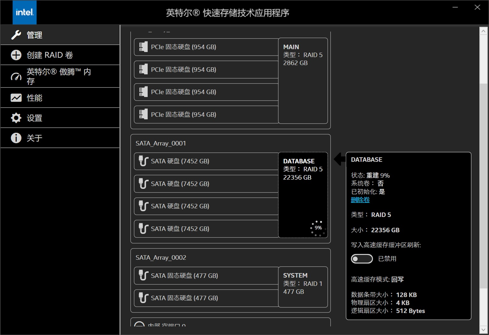

# Intel 阵列显示「发生故障」，一块盘显示「Non-RAID」——怎么把它救回来

[English](README.md) | **简体中文** | [日本語](README.ja.md) | [Deutsch](README.de.md) | [Español](README.es.md) | [Русский](README.ru.md)

盘没坏，只是**被写成了坏**——而这个写法可以改回来。

这里记录一次真实的 24 TB Intel RST RAID 5 恢复：固件已经把卷判成 **`Failed`**，其中一块成员盘
永久卡在 **`Non-RAID`**。全程没有格式化、没有删卷，数据完整回来。
**总共只改了 22 个字节。**

仓库里同时给出我们用过的工具，和完整的字节级说明——你可以照着做，也可以先审一遍再决定信不信。

---

## 先看这 30 秒

| 这是 | 这不是 |
|---|---|
| 针对**一种特定情况**的修复：阵列是 `Failed`，其中一块盘显示 `Non-RAID`，其余盘上的数据还在 | 通用数据恢复工具 |
| 解释**为什么重插线、重启、刷 BIOS、升驱动全都没用**，以及什么才有用 | 一键程序。你会直接改裸盘上的字节。 |
| 一份**带真实序列号和真实哈希**的完整案例，可以拿来和自己的机器逐项比对 | 安全操作。没有撤销。偏移算错就是彻底毁掉阵列。 |

如果只能记住一句话：**你的盘是好的，它的名字牌写错了。**
看完下面[到底出了什么问题](#到底出了什么问题)，两分钟就能明白自己的情况。

## 这是你遇到的情况吗？

逐条打勾。大多数打不上，这一页大概就帮不到你。

- [ ] Intel RST / Optane / VMD 的 **RAID 5**，**4 块盘**（3 块或 5 块同理，只是算法不同）
- [ ] BIOS 的 RST 界面和/或 Windows 的 Intel RST 程序里，卷显示 **`Failed`（发生故障）**
- [ ] **有一块**盘被报成 **`Non-RAID`**、未知，或者在程序里多出一条 **0 字节 / 状态「丢失」** 的幽灵记录
- [ ] 那条幽灵记录的序列号长这样：`你的序列号:0`——真实序列号后面**多了两个字符 `:0`**
- [ ] 其余盘是健康的，而且这次故障源自**线缆、接口、供电或搬动机箱**
- [ ] 你**没有**初始化、删除、重建过这个卷，也**没有**在 BIOS 里点过「标记为正常」
- [ ] 你**没有**让重建跑到那块存着唯一好数据的盘上

**如果卷已经被删除或初始化过：请停手。** 那是另一类故障，本文的方法不适用。

## 到底出了什么问题

Intel 的 RAID 控制器并不是把阵列信息存在一个地方。它会在**每一块盘的末尾**写一份**小铭牌**，
而每份铭牌描述的是**整个阵列**：哪几块盘属于它、什么顺序、每块盘现在什么状态。

关键在于：**某块盘掉线时，控制器不会把它的名字删掉，而是给它打上记号**，而且是很具体的几种记号：

| 铭牌上的内容 | 正常时 | 掉线后 |
|---|---|---|
| 这块盘的名字 | `VLK5JGVY` | **`VLK5JGVY:0`** ← 后面被追加了两个字符 |
| 它的状态 | 存活 | **失败（failed）** |
| 到哪儿找它 | 一个端口号 | **未知** |
| 是否同步 | 是 | **否** |

控制器认盘的方式，是把**铭牌上的名字**和**盘自己报出来的名字**做比较，而且是**逐字符完全相等**。

于是出事后：铭牌上写的是 `VLK5JGVY:0`，盘自己说的是 `VLK5JGVY`，两边永远对不上，
这块盘从此就只能显示 `Non-RAID`。**重插、重启、刷 BIOS、升驱动都改变不了这件事**，
因为不匹配的是存在盘上的文本，不是硬件。

卷显示 `Failed` 还有第二个原因：控制器会数「有几个成员不对劲」。这次是**两个**——
几小时前松脱、漏掉了一段写入的那块，加上这块。4 盘 RAID 5 只容得下 1 个，2 个就是 `Failed`。

## 修复只有一句话

**把这块盘的真实名字写回铭牌，清掉它身上「失败」和「不同步」的记号，把阵列状态改成 `Degraded`
（只剩那个真正漏写过写入的盘是问题成员），重算铭牌校验和，再把同一份改好的铭牌写进每一块存活的盘
——这样就没有任何东西需要固件去猜了。**

本次的实际改动：

| 盘 | 改动字节数 | 位置 |
|---|---:|---|
| 那块 `Non-RAID` 盘（`VLK5JGVY`） | **22** | 盘最末尾的一个 4 KiB 块 |
| 另外两块健康盘 | 各 **15** | 各自同样的位置 |

**数据区改动 0 字节。** 分区表没动，文件没动。

## 结果

| 阶段 | 屏幕上的显示 |
|---|---|
| 修复前 | `Failed`；该盘 `Non-RAID`；一条 **0 字节 / 丢失**、序列号 `VLK5JGVY:0` 的幽灵记录 |
| 只接三块修好的盘开机 | **`Degraded`（降级）**——该盘重新成为成员，缺失的变成了**另一块** |
| 把缺失的那块接回去 | **`Rebuild`（重建）** 自动开始 |
| 进 Windows | 24 004 676 026 368 字节——与原始容量完全一致——挂载成功，文件正常打开 |



*修复之后：四块成员全部在位，卷回到 RAID 5，**状态：重建 9%**。那条 `0 字节 / 丢失` 的幽灵记录消失了。*

被改过铭牌的三块盘，完整撑过了一次对第四块盘的重建。

## 停一下——动手前先读这些

1. **没有撤销。** 我们没有全盘备份，你多半也没有。读两遍，写一次。
2. **绝不能直接写 584 字节的裸块。** 铭牌被拆在**同一个 4 KiB 物理扇区**里的两个扇区上。
   必须读出整 4 KiB、只改铭牌那几段、再整 4 KiB 写回。
3. **绝对不要把卷设成 `Normal`。** `Normal` 的意思是「所有盘都同步」。如果某块盘其实落后了，
   `Normal` 会让系统**安静地返回旧数据**——所有校验都通过，文件却在悄悄变坏。
   在真正重建完成之前，`Degraded` 是唯一诚实的状态。
4. **验证之前不要让 Windows 以可写方式挂载。** NTFS 会回放日志，往降级阵列里写。
   用 `mountvol /N` 或 `Set-Disk -IsReadOnly $true`。
5. **重要数据复制出去之前，别跑 `chkdsk /f`。**
6. **不要「多试几种」。** 每次进 BIOS 的 RST 界面都可能改写铭牌。先只读、再决策、只动一次。
7. **不要照抄我们的数字。** 不同型号容量和扇区大小都不同。本文偏移适用于
   8 001 563 222 016 字节、512/4096 扇区的盘。你自己的必须重算。

## 自己动手

需要：一个 USB-SATA 硬盘盒/转接线、一台 Windows（或 Linux）、以及耐心。
每一步的理由和细节见 **[docs/03-procedure.md](docs/03-procedure.md)**。

```
第 1 步  把所有盘从主板上摘下来，一次只通过 USB 接一块。
第 2 步  每块盘末尾 64 KiB 读两遍、算哈希、留好备份。
第 3 步  从最后 4 KiB 里切出 584 字节的铭牌并解码，把四份铭牌摆在一起比。
第 4 步  在内存里构造修好的铭牌（只改 5 个字段），核对校验和。
第 5 步  干跑写入工具，看清它说要改哪些字节，然后写入并让它回读校验。
第 6 步  只把修好的盘接回主板，进 BIOS 的 RST 界面看结果。
```

具体命令：

```powershell
# 接的是哪块盘？容量和扇区几何必须与成员盘完全一致
Get-Disk | Where-Object BusType -eq 'USB' |
  Select-Object Number,FriendlyName,Size,LogicalSectorSize,PhysicalSectorSize

# 只读：确认是你以为的那块盘，并导出它的铭牌
python scripts\verify_present_state_readonly.py <盘号> <ATA序列号>

# 只读：解码任意一份 584 字节铭牌，逐字段打印
python scripts\dump_cfg.py samples\VLK5JGVY_IMSM_configuration.bin

# 干跑——任何一项校验不过就拒绝，不加 --apply 绝不写盘
python scripts\apply_mpb_write.py <盘号> <ATA序列号>

# 所有守护条件都过了，才执行
python scripts\apply_mpb_write.py <盘号> <ATA序列号> --apply
```

脚本就是当时在真盘上跑的那几个，文件顶部有本案例写死的常量。
**用之前必须按自己的盘改掉**——它不是安装器。

## 仓库里有什么

| 路径 | 用大白话说是什么 |
|---|---|
| [docs/01-case-study.md](docs/01-case-study.md) | 完整故事：逐小时时间线，以及网上那些建议为什么都不管用 |
| [docs/02-imsm-metadata-format.md](docs/02-imsm-metadata-format.md) | 584 字节铭牌的完整地图：每个字段、每个比特、校验和公式 |
| [docs/03-procedure.md](docs/03-procedure.md) | 带命令的分步操作手册，含我们实际踩到的坑 |
| [docs/04-hardware.md](docs/04-hardware.md) | 精确的机器配置、磁盘、序列号、几何，方便你逐项对照 |
| [docs/05-evidence.md](docs/05-evidence.md) | 所有哈希和逐字节改动清单，供你审计而不是盲信 |
| [docs/06-references.md](docs/06-references.md) | Intel 通告、`mdadm` 源码、内核源码 |
| `scripts/` | 只读检查工具 + 一个带多重校验的写入工具 |
| `samples/` | 修复前四块盘的真实铭牌，以及修好的那一份 |

## 常见问题

**我的卷是 `Failed`，但没有盘显示 `Non-RAID`，适用吗？**
大概不适用。本文解决的是「成员盘无法重新入组」。如果四块盘都在、卷还是 `Failed`，
那是另一类问题。

**能不能直接在 BIOS 里点「标记为正常」？**
不能。那会写一份「全部同步」的铭牌，而这是假话。它掩盖差异而不是修复差异；
而且控制器本来就会从各块盘反推状态，很可能把你这次修改直接「纠正」回去。

**那块失步盘的数据会不会丢？**
如果对它执行重建，会——它的数据区会被按其余盘重算的值覆盖。在线缆故障这类场景里，
方向是对的（其余盘更新）。但先把你在意的东西拷出来。

**只改坏的那一块行不行？**
建议全部存活成员都改。只改一块的话，其余盘上仍然写着「这个槽位已死」。
固件会信哪一份，你无法验证——我们不想赌，所以把每一份铭牌都写成一样的。

**能不能在 Linux 里做？**
可以，而且可能更安全：`mdadm --examine /dev/sdX` 会把同样的字段打出来，
再用 `dd` 或 mdadm 自己的 `--update` 写入。格式完全一样。

**RAID 1 / RAID 10 / RAID 6 适用吗？**
铭牌格式相同，但「几个成员算太多」的规则不同。先看 `docs/02` 和 mdadm 源码再决定。

**升级 Intel 驱动能修好吗？**
不能。阵列是 Windows 启动**之前**、由主板 BIOS 里的代码组装的，驱动版本只影响之后。
这也正是 Intel 那个掉线 BUG 的真正修复只能由主板厂商以 **BIOS 更新**形式给出的原因。

**这算不算在「黑」我的硬盘？**
这是在写一条配置记录里的六个字段——Intel 自己的软件每次变更时也在写同样的东西。
它可逆的程度，就等于那份记录的备份程度，所以第 2 步是「留备份」。

**我的盘是 10 TB / 14 TB / 别的牌子。**
那所有偏移都不一样。读 `docs/02`，自己算，写之前先拿自己盘的转储核对。

## 给想深挖的人

一句话版：这份铭牌是 Intel 的 **MPB**（MetaData Parameter Block），签名
`Intel Raid ISM Cfg Sig. 1.3.00`，4 盘单卷时 584 字节，写在每块盘最后两个 512 字节扇区里。
校验和就是小端 32 位字求和。全部偏移、状态位、状态推导规则都在
**[docs/02-imsm-metadata-format.md](docs/02-imsm-metadata-format.md)**。

这些行为是从公开的 `mdadm` 对该格式的实现推导出来的，然后在真实固件上验证过：
我们离线算出的阵列状态，与 BIOS 显示的完全一致——修复前后都是。

## 参考资料

- **Intel 官方通告（一切的起点，掉线 BUG）：**
  <https://www.intel.com/content/www/us/en/support/articles/000099952/technologies.html>
- `mdadm` 的 IMSM 实现——这个格式最权威的公开描述：
  <https://raw.githubusercontent.com/md-raid-utilities/mdadm/main/super-intel.c>
- Linux `drivers/md/raid5.c`、`fs/ntfs3/*`——详见 [docs/06-references.md](docs/06-references.md)

## 许可

MIT，见 [LICENSE](LICENSE)。序列号、型号、几何尺寸经所有者同意公开。
数据无价，能救回一份就值得写下来。
