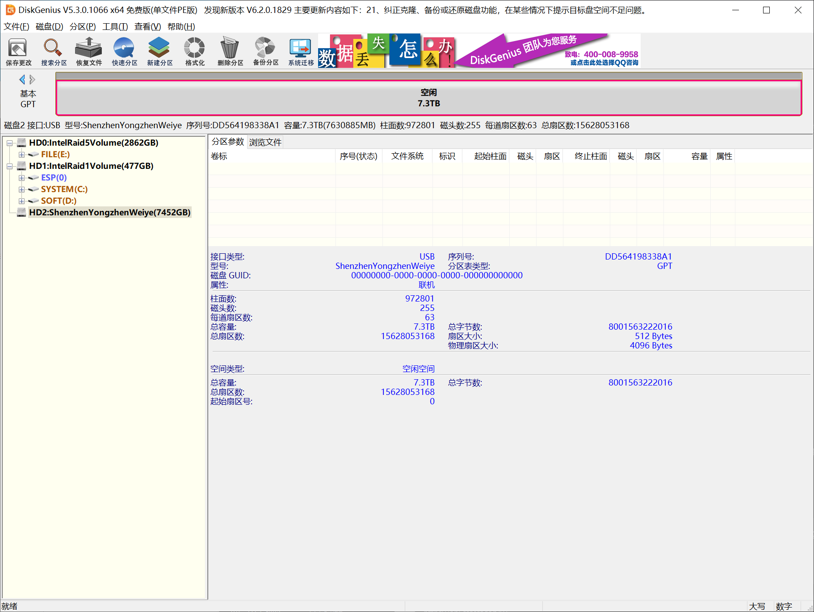
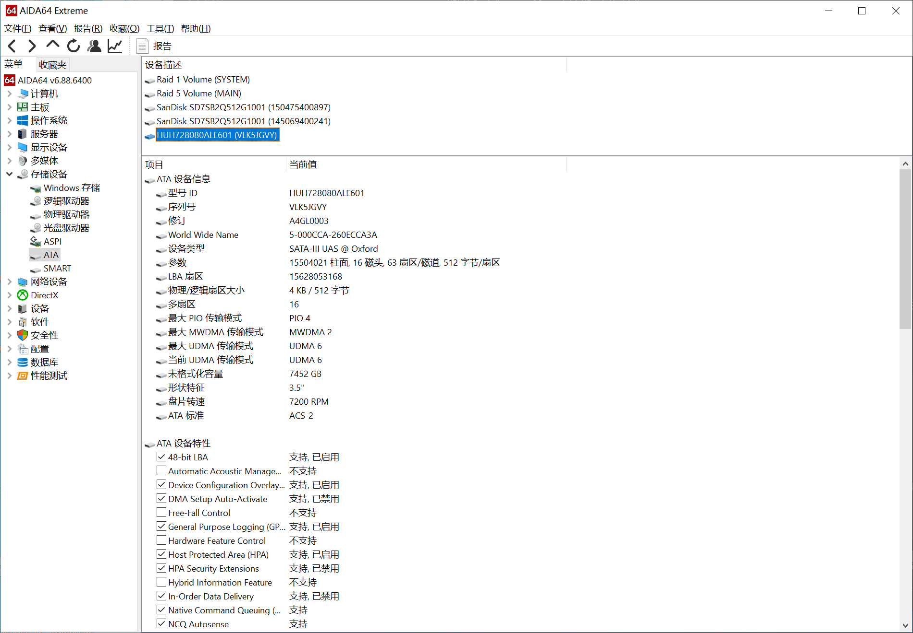
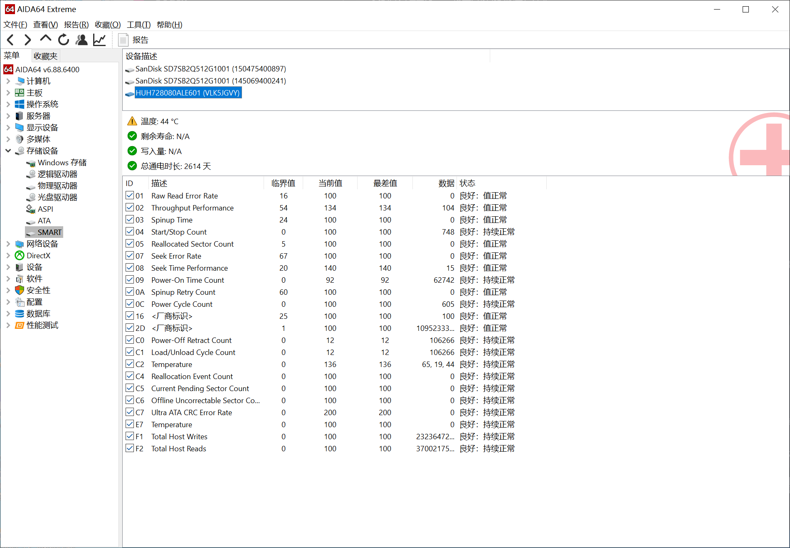

# Intel RST / IMSM RAID 5：把被固件踢成 `Non-RAID` 的成员盘救回阵列（`Failed` → `Degraded` → `Rebuild`）

[English](README.md) | **简体中文** | [日本語](README.ja.md) | [Deutsch](README.de.md) | [Español](README.es.md) | [Русский](README.ru.md)

> 一次真实、有完整证据链、成功收尾的 4 盘 Intel RST RAID 5（卷名 `DATABASE`，24 TB）恢复。
> 固件已把卷判为 **Failed**，其中一块成员盘卡在 **`Non-RAID`**。
>
> 最终结果：**`Failed` → `Degraded` → `Rebuild` → 挂载成功、文件可读。**
> 全程没有格式化、没有删卷、没有初始化，也从来没有过全盘备份。

---

## 一句话版本

卷是 `Failed`，一块成员盘（`VLK5JGVY`）被报成 `Non-RAID`；其余成员数据完好，连文件系统结构都能离线读出来。

整个故障**只是元数据问题**。我们在这块盘最末尾的一个 4 KiB 物理扇区里改了 **22 个字节**，
下次开机固件就接受了。

本仓库给出全部细节：精确的字节布局、精确的字段取值、只读核对脚本、带多重前置校验的写入工具。

如果你正因为阵列显示 `Failed` 找到这里，**先读[动手前的警告](#动手前的警告)。**

---

## 症状

成员盘丢失后又被接回，Intel RST 的典型表现：

| 位置 | 现象 |
|---|---|
| BIOS / UEFI 里的 RST（OROM） | 卷存在但状态 `Failed`；接回的盘显示为 `Non-RAID` |
| Windows 里的 RST 界面 | 多出一条幽灵记录：**大小 0 Bytes、状态 丢失、控制器/端口 未知**，序列号带 `:0` 后缀（例如 `VLK5JGVY:0`） |
| 磁盘本身 | 物理健康。ATA `IDENTIFY` 序列号、容量、SMART 全部正常 |

盘**没坏**，也**没空**。它只是带着一份元数据，上面写着"这个槽位属于一个缺失/失败的成员"，
所以固件拒绝把这块物理盘绑定到那个槽位。

<table>
<tr>
<td width="50%"><br><i>拆出阵列、用 USB 转接后的一块成员盘。注意 <code>512 B</code> 逻辑 / <code>4096 B</code> 物理扇区，共 <code>15628053168</code> 扇区。</i></td>
<td width="50%"><br><i>透过 USB 桥（<code>SATA-III UAS @ Oxford</code>）仍能完整读到 ATA 身份：序列号、LBA 数、4K/512 几何、WWN。</i></td>
</tr>
<tr>
<td colspan="2"><br><i>同一块盘的 SMART：重映射扇区 0、待定扇区 0、离线不可纠正 0。一块完全健康的盘，却被固件判成 <code>Non-RAID</code>。</i></td>
</tr>
</table>

## 根本原因

Intel RST 把阵列配置存在一个叫 **MPB**（MetaData Parameter Block）的结构里，写在**每一块**成员盘的**最末尾**。
盘上的签名是：

```
Intel Raid ISM Cfg Sig. 1.3.00
```

每块成员盘都保存**整份阵列描述**的完整副本，而不只是自己那条记录。
某块盘消失时，控制器不会删掉它的记录，而是**给它打标记**，而且一次打三处：

| 字段 | 成员缺失时的值 | 含义 |
|---|---|---|
| `disk[i].status` | `0x00000006`（`CONFIGURED \| FAILED`） | 槽位存在，但已死 |
| `disk[i].scsi_id` | `0xFFFFFFFF` | "我不知道这块盘在哪" |
| `disk[i].serial` | 真实序列号 **后接 `:0`** | 别拿它去匹配物理盘 |
| `map.disk_ord_tbl[slot]` | 置位 `0x01000000`（`IMSM_ORD_REBUILD`） | 这个成员已不同步 |

这不是猜的：它与公开的 `mdadm` IMSM 实现里 `mark_failure()` / `mark_missing()` 写出的内容完全一致
（见[参考资料](docs/06-references.md)）。

**真正致命的是序列号。** 成员匹配是对 **16 字节序列号字段**做 `strncmp`。
`"VLK5JGVY:0"` 不等于 `"VLK5JGVY"`，所以无论你重启多少次、重插多少次线，
这块物理盘都永远绑不回它自己的槽位。

更麻烦的是卷状态是**从成员反推**出来的：

```
失败槽位数 = 置了 FAILED 位的槽位数 + 置了 IMSM_ORD_REBUILD 的槽位数
RAID5 失败 1 个 -> Degraded
RAID5 失败 2 个及以上 -> Failed
```

本案**两个**槽位同时被判失败：被拔掉的那块，以及几小时前就已经失步的那块。
4 盘 RAID5 坏 2 个 = `Failed`，只要元数据不变，永远是 `Failed`。

## 我们实际做了什么

完整步骤见 [docs/03-procedure.md](docs/03-procedure.md)。简版：

1. **把所有成员盘从主板上摘下来。** 控制器不参与，固件没有机会"顺手"改写任何东西。
2. **通过 USB-SATA 桥只读读取每块盘末尾 64 KiB**，每段读两遍并比对一致，保存 SHA-256。
3. **定位盘上的 MPB。** 它**不是**连续的 584 字节目录：
   - 锚点扇区（配置字节 `0..511`）位于 `最后LBA - 1`
   - 扩展部分（配置字节 `512..583`）位于 `最后LBA - 2` 的**前 72 字节**
   - 两者落在**同一个 4 KiB 物理扇区**内——必须整扇区读-改-写，绝不能只写 584 字节。
4. **按公开 `mdadm` 源码的字段表解析全部四份副本**并比对：三份完全相同、校验通过（代次 763553）；
   被踢出的那块是旧副本（代次 763509），且**校验和不符**。
5. **以最新有效副本为基线构造修复配置**，只改必须改的：
   - B 的序列号字段：`"VLK5JGVY:0"` → `"VLK5JGVY"`（+NUL + 它自己的 5 字符后缀）
   - B 的 `status`：`0x00000006` → `0x0000053a`（清 `FAILED`，保留健康成员的其它标志位）
   - B 的 `scsi_id`：`0xFFFFFFFF` → `0x00000000`（该盘自己历史上被写入过的值）
   - B 的 `disk_ord_tbl[2]`：`0x01000002` → `0x00000002`（清 `IMSM_ORD_REBUILD`）
   - `map.map_state`：`3`（Failed）→ `2`（Degraded）
   - `generation_num`：`763553` → `763554`
   - 重算校验和
   - **完全不动**：阵列 family、卷 ID/卷名/容量、成员数、RAID 级别、条带大小、数据起点、
     `failed_disk_num`、**其它成员**的记录，以及那块真正漏过写入的成员身上的失步标记。
6. **把同一份 584 字节配置写进所有存活成员**（每块盘一次 4 KiB 读-改-写），
   让所有副本**逐字节完全一致**——这样固件开机时不存在任何跨代次歧义要裁决。
7. **回读校验**：整扇区、校验和、磁盘身份全部核对。

对阵列的实际改动：**被踢出的那块盘 22 字节，另两块各 15 字节**，全部落在每块盘最末尾的元数据扇区内。
数据区一个字节都没碰。

## 结果

| 阶段 | 实测现象 |
|---|---|
| 修复前 | `Failed`；`VLK5JGVY` 显示 `Non-RAID`；幽灵记录 `VLK5JGVY:0`、`0 Bytes`、`丢失` |
| 写完三块盘、只接这三块开机 | **`Degraded`**，`VLK5JGVY` 回到阵列成为成员，缺失成员为 `VKJGM9XX` |
| 再把失步那块接回 | **`Rebuild`**，自动开始重建 |
| 进 Windows | `Intel Raid 5 Volume DATABASE`，24 004 676 026 368 字节，**Healthy / OK**，成功挂载，文件正常打开 |

被修过元数据的三块盘完整撑过了一次重建，卷回来了。

## 动手前的警告

1. **改错就是不可逆的。** 我们没有全盘备份，你多半也没有。写错一个偏移或一个校验和，
   可恢复的阵列就真没了。
2. **绝不要直接写 584 字节的裸块。** 配置被拆在同一个 4 KiB 物理扇区里的两个扇区上。
   必须读出整扇区、只改 MPB 那几段、再整扇区写回。
3. **绝对不要把卷设成 `Normal`。** `Normal` 只是宣称"所有成员都已同步"。如果某个成员其实是旧数据，
   `Normal` 会把问题藏起来：读那块盘会返回过期内容，而所有结构校验照样通过——这就是静默损坏。
   在真正重建发生之前，`Degraded` 是唯一诚实的状态。
4. **在验证之前，不要让 Windows 以可写方式挂载。** NTFS 会回放日志、往降级阵列里写东西。
   先用 `mountvol /N` 或用 `Set-Disk -IsReadOnly $true` 把盘设为只读。
5. **重要数据复制出来之前，不要跑 `chkdsk /f`。**
6. **不要反复"试一试"。** 每次进 RST OROM 都可能改写元数据。先只读、再决策、只动一次。
7. 每块盘的型号、容量、几何都不同。本文的偏移适用于 `8001563222016` 字节、512/4096 扇区的成员盘。
   **必须重算，绝不能照抄数字。**

## 仓库结构

```
README.md                     英文主文档
README.zh-CN.md               本文件（完整中文版）
README.ja/de/es/ru.md         日/德/西/俄 精简指南
docs/01-case-study.md         完整案例：时间线、排查过程、排除掉的假设
docs/02-imsm-metadata-format.md  584 字节 MPB 字段表、校验和、状态位
docs/03-procedure.md          带命令的操作手册
docs/04-hardware.md           精确的机器配置、磁盘、序列号、几何
docs/05-evidence.md           哈希、回读证明、逐字节改动清单
docs/06-references.md         Intel 通告、mdadm 源码、内核源码
docs/images/                  截图
scripts/                      只读检查工具 + 带守护的写入工具
samples/                      四份真实的 584 字节配置（修复前）+ 修复后的目标配置
```

## 自己动手的入口

```powershell
# 1. 只读：解码任意一份 584 字节配置的全部字段
python scripts\dump_cfg.py samples\VLK5JGVY_IMSM_configuration.bin

# 2. 只读：核对当前接入磁盘的身份与现有元数据
python scripts\verify_present_state_readonly.py 2 VLK5JGVY

# 3. 干跑写入工具（任何一项校验不过就拒绝，不加 --apply 绝不写盘）
python scripts\apply_mpb_write.py 2 VLK5JGVY

# 4. 只有全部前置校验通过后
python scripts\apply_mpb_write.py 2 VLK5JGVY --apply
```

**动手前必读** [docs/03-procedure.md](docs/03-procedure.md)。仓库里的脚本就是本案例实际使用的版本，
每个文件顶部都有本次案例写死的常量——**用之前按自己的盘改掉**，它不是通用安装器。

## 参考资料

- **Intel 官方通告（一切的起点）：**
  <https://www.intel.com/content/www/us/en/support/articles/000099952/technologies.html>
- `mdadm` IMSM 参考实现（这个格式最权威的公开描述）：
  <https://raw.githubusercontent.com/md-raid-utilities/mdadm/main/super-intel.c>
- Linux `drivers/md/raid5.c`、`fs/ntfs3/*` — 详见 [docs/06-references.md](docs/06-references.md)

## 关于固件版本的结论

把 **Windows** 侧的 RST 驱动 / RST 管理程序升到新版本，**不改变**开机时阵列如何被组装。
**BIOS 里内嵌的 OROM** 才是第一个枚举磁盘、判定阵列状态、写元数据的代码。
所以本次修复必须使用 `1.3.00` 的 MPB 格式——19.x 的 OROM 原生解析它；
也所以 Intel 那个掉线问题通告的修复，只能由主板厂商以 BIOS 更新的形式给出。

## 许可

MIT，见 [LICENSE](LICENSE)。案例中的序列号、型号、几何尺寸经所有者明确同意公开，
希望能帮到下一个踩同一个坑的人。
